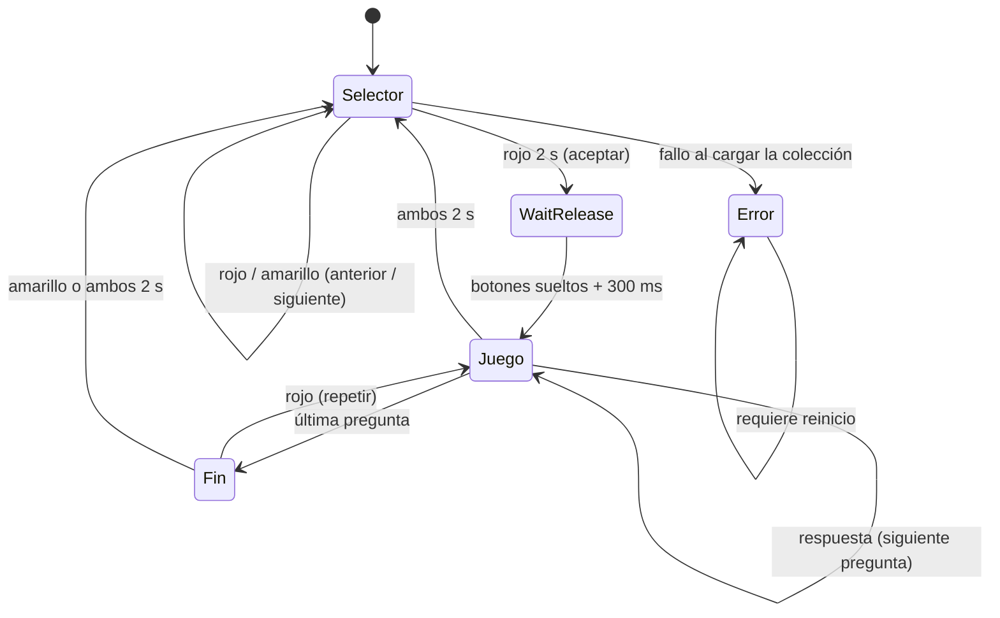

# English Kids

Dispositivo educativo basado en ESP32-S3 que muestra una palabra en español (con una imagen) y dos posibles traducciones al inglés. El niño elige con dos botones físicos. Las colecciones de vocabulario no van compiladas en el firmware: se descargan desde este repositorio de GitHub y se guardan en LittleFS.

Este documento es a la vez documentación técnica del firmware y guía de mantenimiento para añadir colecciones, palabras e imágenes sin tocar el código del juego.

---

## Índice

1. [Arquitectura](#1-arquitectura)
2. [Estructura de contenidos](#2-estructura-de-contenidos)
3. [Cómo añadir una colección](#3-cómo-añadir-una-colección)
4. [Generación y actualización de imágenes](#4-generación-y-actualización-de-imágenes)
5. [Firmware: compilación, carga y actualización](#5-firmware-compilación-carga-y-actualización)
6. [Resolución de problemas](#6-resolución-de-problemas)
7. [Limitaciones conocidas y notas de mantenimiento](#7-limitaciones-conocidas-y-notas-de-mantenimiento)

---

## 1. Arquitectura

### 1.1 Qué hace el dispositivo

1. Al arrancar muestra la cabecera `ENGLISH KIDS` e intenta conectarse al WiFi (máximo 15 segundos).
2. Monta LittleFS (sin formatear nunca de forma automática).
3. Descarga el catálogo de colecciones si hay red y carga el contenido de la colección activa (también desde la red si hay conexión).
4. Muestra **siempre** el selector de colecciones al arrancar, conservando la última colección confirmada.
5. Al confirmar una colección empieza una partida: se recorre **todas** las palabras de la colección en orden aleatorio. En cada pregunta se muestra la palabra en español, su imagen y dos opciones en inglés (la correcta y un distractor aleatorio de la misma colección, en lado aleatorio).
6. Botón rojo = opción izquierda, botón amarillo = opción derecha. Cada acierto suma un punto; tras 1,1 s de feedback se pasa a la siguiente pregunta.
7. Al terminar la colección se muestra el resultado (`aciertos/total`) y las opciones **REPETIR** (rojo) y **CAMBIAR** (amarillo, abre el selector).

El juego no guarda puntuaciones entre partidas ni entre reinicios.

### 1.2 Hardware

| Componente | Detalle |
|---|---|
| Placa | ESP32-S3-DevKitC-1 **N16R8** (16 MB flash QIO, 8 MB PSRAM octal) |
| Pantalla | TFT ILI9341 de 2,8" (320×240), bus SPI, sin uso de táctil |
| Entrada | Dos pulsadores (rojo y amarillo) |
| Almacenamiento | LittleFS en la partición `spiffs` de la flash interna |

Conexiones definidas en `include/hardware.h`:

| Señal | GPIO |
|---|---|
| TFT CS | 4 |
| TFT DC | 2 |
| TFT RST | 1 |
| TFT MOSI (SDA) | 11 |
| TFT SCK (SCL) | 12 |
| TFT MISO | 13 (declarado en `SPI.begin`, no se usa para escribir) |
| Botón rojo | 6 |
| Botón amarillo | 7 |

Detalles de conexión y configuración:

- La pantalla se inicializa con `tft.setRotation(1)`, es decir, en horizontal (320×240 lógicos). Todas las coordenadas del código (`src/display.cpp`) asumen ese tamaño.
- No se controla el backlight de la pantalla desde el firmware.
- Los botones se configuran como `INPUT_PULLUP`: deben cerrar el GPIO contra **GND** y se leen como pulsados cuando el pin está a `LOW`. No necesitan resistencias externas.
- El bus SPI se inicializa con `SPI.begin(TFT_SCK, TFT_MISO, TFT_MOSI, TFT_CS)`.
- `ARDUINO_USB_CDC_ON_BOOT=0`: `Serial` sale por el UART0 de la placa. Para ver la consola hay que usar el puerto USB etiquetado **UART** del DevKitC, no el puerto nativo "USB".

### 1.3 Arquitectura del firmware

Firmware Arduino sobre PlatformIO, organizado en módulos con una responsabilidad cada uno:

| Archivo | Responsabilidad |
|---|---|
| `src/main.cpp` | Punto de entrada. Conexión WiFi, secuencia de arranque, máquina de estados de la aplicación y reparto de entradas a cada pantalla. Define las URLs base (`GITHUB_RAW`, `CONFIG_URL`, `CATALOG_URL`). |
| `src/collections.cpp` | Descarga y parseo de `collections.json` y de `collections/{id}/content.json`; catálogo en RAM; colección activa; persistencia de la colección seleccionada; navegación anterior/siguiente. |
| `src/game.cpp` | Lógica de la partida: barajado de palabras, elección de la opción correcta y del distractor, comprobación de respuestas, puntuación y fin de partida. |
| `src/display.cpp` | Todo el dibujado: cabecera, pregunta, imagen, botones de opción, pantalla final, selector y pantalla de error. Texto en español mediante U8g2 (UTF-8) y texto en inglés mediante la fuente de Adafruit GFX. |
| `src/images.cpp` | Descarga de imágenes RGB565, validación por tamaño y SHA-256, carga en el búfer de vídeo y actualización de las imágenes de la colección activa. |
| `src/storage.cpp` | Montaje de LittleFS y escritura atómica de archivos (`.tmp` → `.bak` → archivo final). |
| `src/input.cpp` | Lectura de botones con antirrebote, detección de pulsación larga y de la combinación de ambos botones. |
| `src/hardware.cpp` | Pines, inicialización de SPI y de la pantalla, lectura directa de cada botón. |
| `include/config.h` | Límites del sistema (número de colecciones y palabras, longitudes máximas, tamaño de imagen, capacidades de los buffers JSON y tiempos de pulsación). |
| `include/secrets.h` | Credenciales WiFi (`WIFI_SSID`, `WIFI_PASSWORD`). **No está en el repositorio** (`.gitignore`). |

La pantalla se organiza en zonas fijas: cabecera azul de 32 px con el título de la colección y el contador `actual/total`; palabra española centrada en `y = 42`; imagen de 120×120 en `(100, 65)`; recuadros de opción de 140×48 en `y = 190` (izquierda `x = 10`, derecha `x = 170`).

### 1.4 Máquina de estados



En la pantalla final, el botón **rojo inicia una partida nueva** de la misma colección; el amarillo (o ambos durante 2 s) vuelve al selector. `STATE_ERROR` es terminal: el dispositivo queda bloqueado hasta reiniciarlo.

| Pantalla | Rojo corto | Amarillo corto | Rojo 2 s | Ambos 2 s |
|---|---|---|---|---|
| Selector | colección anterior | colección siguiente | **aceptar** | — |
| Juego | opción izquierda | opción derecha | — | abrir selector |
| Fin de partida | repetir | abrir selector | — | abrir selector |

Notas de comportamiento:

- `STATE_WAIT_RELEASE` existe para no interpretar como respuesta la pulsación con la que se confirma la colección: espera a que se suelten ambos botones y añade 300 ms.
- La pulsación corta simultánea de ambos botones (`INPUT_BOTH_SHORT`) se detecta pero no se usa en ninguna pantalla.
- Antirrebote: 180 ms (`DEBOUNCE_DELAY`). Pulsación larga: 2000 ms (`LONG_PRESS_DELAY`).
- `STATE_ERROR` dibuja el mensaje en pantalla y deja el dispositivo bloqueado; hay que reiniciar.

### 1.5 Tecnologías y librerías

- **PlatformIO Core 6.x** con el framework Arduino para ESP32 (`platform = espressif32`, board `esp32-s3-devkitc-1`).
- **Adafruit GFX Library** y **Adafruit ILI9341**: driver y primitivas de dibujo.
- **U8g2_for_Adafruit_GFX**: texto UTF-8 con acentos y `ñ` para la palabra en español (fuente `u8g2_font_helvB18_tf`).
- **ArduinoJson `^6.21.5`**: parseo de los JSON (`DynamicJsonDocument`).
- **LittleFS** (incluida en el core): sistema de archivos.
- **WiFi**, **WiFiClientSecure**, **HTTPClient** y **mbedtls** (SHA-256): descarga por HTTPS y verificación de integridad.
- **Python + Pillow** y **Cloudflare Workers AI** para generar las imágenes (`tools/`).

---

## 2. Estructura de contenidos

### 2.1 Organización del repositorio

```
.
├── collections.json              Catálogo de colecciones que descarga el dispositivo
├── config.json                   Colección por defecto (uso opcional, ver 2.3)
├── platformio.ini                Configuración de PlatformIO
├── include/                      Cabeceras del firmware
│   ├── config.h                  Límites y constantes
│   ├── secrets.h                 Credenciales WiFi (no versionado)
│   └── ...                       Resto de cabeceras de módulos
├── src/                          Implementación del firmware
├── collections/                  Fuente de los contenidos (se publican tal cual)
│   └── {id}/
│       ├── content.json          Palabras y metadatos de imagen
│       └── images/
│           └── {palabra}.rgb565  Imágenes 120×120 RGB565 little-endian
└── tools/                        Utilidades de generación y mantenimiento (Python)
    ├── generar_imagenes.py       Genera imágenes con Cloudflare y actualiza metadatos
    ├── generar_manifest.py       Recalcula size/sha256/available de todas las colecciones
    ├── ver_imagenes.py           Convierte RGB565 a PNG para revisarlas
    └── convertir_rgb565.py       Utilidad puntual: arrays C a .rgb565
```

El firmware **no** incluye contenidos en la flash de fábrica. Lee de este mismo repositorio (`mgutbor/english-kids-images`, rama `main`) mediante `raw.githubusercontent.com`, usando las URLs declaradas al principio de `src/main.cpp`:

```
https://raw.githubusercontent.com/mgutbor/english-kids-images/main/
https://raw.githubusercontent.com/mgutbor/english-kids-images/main/config.json
https://raw.githubusercontent.com/mgutbor/english-kids-images/main/collections.json
```

Publicar contenido = hacer `push` a `main` en ese repositorio. Si el repositorio cambia de nombre, de rama o se bifurca, hay que actualizar esas tres constantes en `src/main.cpp`.

### 2.2 `collections.json`

Catálogo de colecciones. Es lo primero que se descarga y determina qué aparece en el selector. Extracto del catálogo real (que tiene 5 colecciones):

```json
{
  "collections": [
    {
      "id": "basic-adjectives",
      "title": "Basic adjectives"
    },
    {
      "id": "toys",
      "title": "Toys"
    },
    {
      "id": "family-members",
      "title": "Family members"
    }
  ]
}
```

| Campo | Obligatorio | Reglas |
|---|---|---|
| `collections` | Sí | Array con entre 1 y 20 elementos (`MAX_COLLECTIONS`). |
| `id` | Sí | Solo minúsculas, dígitos y guion (`a-z`, `0-9`, `-`). Máximo 47 caracteres. Debe coincidir **exactamente** con el nombre de la carpeta. Los elementos con `id` inválido se descartan en silencio. |
| `title` | Sí | Nombre visible en la cabecera y en el selector. No puede estar vacío. Máximo 63 caracteres; recomendado 16-18, porque se dibuja con `setTextSize(2)` en una cabecera de 320 px junto al contador, sin recorte ni ajuste, y un título más largo se solapa con el contador. |

El firmware guarda una copia local en `/collections.json`. Si el JSON descargado no es válido, la descarga se rechaza y se conserva el catálogo anterior. Si el array supera las 20 colecciones, se rechaza el catálogo completo: el dispositivo conserva la copia local anterior y no verá ninguna colección nueva. Lo mismo si queda vacío tras validar. Un `id` inválido, en cambio, solo descarta esa entrada.

### 2.3 `config.json`

```json
{
  "version": "1.0",
  "activeCollection": "family-members"
}
```

Se usa como colección por defecto cuando el dispositivo no tiene `/selected_collection.json` **o cuando existe pero no es válido** (JSON corrupto o un `activeCollection` que no cumple las reglas). `version` no lo lee el firmware.

Importante: `config.json` **no se descarga**. La constante `CONFIG_URL` existe en `src/main.cpp` pero ningún flujo la usa; el firmware únicamente intenta leer `/config.json` de LittleFS. Para que tenga efecto hay que subirlo manualmente al sistema de archivos (ver 5.4). En la práctica, la colección se cambia con el selector y se persiste en `/selected_collection.json`; si no hay ni selección ni `config.json`, se usa la primera colección del catálogo.

### 2.4 `content.json`

Contenido de una colección. Un archivo por colección, en `collections/{id}/content.json`. Ejemplo real (`collections/family-members/content.json`):

```json
{
  "version": "1.0",
  "title": "Family Members",
  "words": [
    {
      "id": "mother",
      "spanish": "MADRE",
      "english": "MOTHER",
      "image": {
        "file": "mother.rgb565",
        "available": true,
        "size": 28800,
        "sha256": "03cc168be54f8084642307eef164ba3c770a6ed8a0651c3b8ecc0223174b46f4"
      }
    },
    {
      "id": "father",
      "spanish": "PADRE",
      "english": "FATHER",
      "image": {
        "file": "father.rgb565",
        "available": true,
        "size": 28800,
        "sha256": "dd1a98061019235446f5e6af5680cceacc2d2a57f85b97e1db1a87b1e2efd0af"
      }
    }
  ]
}
```

| Campo | Obligatorio | Uso real en el firmware |
|---|---|---|
| `version` | No | Informativo. El firmware no lo lee. |
| `title` | No | Informativo. El nombre que se muestra viene de `collections.json`, no de aquí. |
| `words` | Sí | Array de 2 a 30 palabras (`MAX_WORDS`). Con menos de 2 el contenido se rechaza y el juego no puede empezar. |
| `words[].id` | Sí | Identificador de la palabra. Máximo 39 caracteres. Se usa también como nombre de archivo de imagen y como clave en `SUBJECTS` de `tools/generar_imagenes.py`. |
| `words[].spanish` | Sí | Texto que ve el niño. Se dibuja con U8g2, así que admite UTF-8 (`Ñ`, `Á`, `Í`…). Máximo 31 bytes (con acentos, ~15 caracteres) y recomendación práctica de hasta 18 caracteres visibles: se dibuja centrado, sin ajuste ni recorte, y una palabra más larga puede salirse de la pantalla. Convención actual: mayúsculas. |
| `words[].english` | Sí | Se dibuja con la fuente de Adafruit GFX dentro de un recuadro de 140×48 a `setTextSize(2)`. **Solo ASCII** (la fuente no soporta acentos) y máximo práctico de ~11 caracteres para que no se salga del recuadro. Convención actual: mayúsculas. |
| `words[].image.file` | No | Nombre de archivo, sin ruta. Máximo 63 caracteres. Debe existir en `collections/{id}/images/`. Si falta, la palabra se muestra sin imagen. |
| `words[].image.available` | No | Debe ser `true` para que el firmware descargue y dibuje la imagen. Si falta o es `false`, la imagen se ignora aunque `file` y `sha256` sean correctos, sin ningún aviso. Lo genera `generar_manifest.py`. |
| `words[].image.size` | No | Informativo: el firmware **no** lo usa. Exige siempre exactamente 28 800 bytes (120 × 120 × 2). |
| `words[].image.sha256` | Sí, para descargar | 64 caracteres hex. El firmware exige longitud 64 y compara el hash del archivo local antes y después de descargar. Si no coincide, la imagen no se usa y se reintenta en el siguiente arranque con red. |

Nota: no construyas el bloque `image` a mano. Genéralo con `generar_imagenes.py` (o con `generar_manifest.py` si el `.rgb565` ya existe). Si lo escribes tú y olvidas `available: true`, el fallo es silencioso: ni la pantalla ni la consola avisan.

Validaciones que aplica el firmware al **descargar** un `content.json`: `words` debe existir, tener entre 2 y 30 elementos, y cada elemento debe traer `id`, `spanish` y `english` no vacíos. Si alguna falla, el archivo descargado se descarta y se mantiene la versión local.

Límites globales relevantes (definidos en `include/config.h`):

| Constante | Valor | Consecuencia práctica |
|---|---|---|
| `MAX_COLLECTIONS` | 20 | Máximo de colecciones en el catálogo. |
| `MAX_WORDS` | 30 | Máximo de palabras por colección. |
| `CATALOG_JSON_CAPACITY` | 4096 bytes | `collections.json` no debería superar ~4 KB (20 entradas cortas caben de sobra). |
| `CONTENT_JSON_CAPACITY` | 16384 bytes | `content.json` debe caber en ~16 KB, metadatos incluidos. |
| `CONFIG_JSON_CAPACITY` | 1024 bytes | `config.json` y `selected_collection.json`. |
| `IMAGE_WIDTH` × `IMAGE_HEIGHT` | 120 × 120 | Imagen fija; no hay escalado en el dispositivo. |
| `IMAGE_BUFFER_SIZE` | 28 800 bytes | Búfer en RAM (`uint16_t imageBuffer[14400]`). |

---

## 3. Cómo añadir una colección

Ejemplo completo: una colección `animals` con dos palabras.

### 3.1 Crear la carpeta de la colección

El nombre de la carpeta es el `id` de la colección: minúsculas, dígitos y guiones.

```bash
mkdir -p collections/animals/images
```

### 3.2 Crear su `content.json`

Puedes empezar con lo mínimo (sin imágenes); los scripts añaden el bloque `image` cuando la generación funciona. Si la generación de una palabra falla, esa palabra se queda sin imagen (o con la anterior, si ya existía) y el firmware la muestra sin imagen.

```json
{
  "version": "1.0",
  "title": "Animals",
  "words": [
    {
      "id": "cat",
      "spanish": "GATO",
      "english": "CAT"
    },
    {
      "id": "dog",
      "spanish": "PERRO",
      "english": "DOG"
    }
  ]
}
```

Reglas al escribirlo: entre 2 y 30 palabras, `id` únicos, `spanish` en mayúsculas con acentos si procede, `english` corto y sin acentos (≈ 11 caracteres máximo), y sin comas finales (no es JSON válido).

### 3.3 Añadir la colección a `collections.json`

Añade el objeto al array, respetando el formato y el máximo de 20:

```json
{
  "id": "animals",
  "title": "Animals"
}
```

El orden del array es el orden del selector.

### 3.4 Incorporar palabras y traducciones

Cada palabra nueva debe tener su propio `id` y su nombre de archivo de imagen derivado: `images/{id}.rgb565`. Los `id` no pueden repetirse dentro de la colección porque el archivo de imagen se nombra con ellos.

Puedes trabajar por tandas: añade las palabras al `content.json`, ejecuta la generación de imágenes y repite. El script no vuelve a generar lo que ya existe (`SKIP`).

### 3.5 Generar e incorporar las imágenes

Requisitos y variables de entorno en el apartado [4](#4-generación-y-actualización-de-imágenes). Resumen:

```bash
python3 tools/generar_imagenes.py --collection animals
```

Esto crea `collections/animals/images/cat.rgb565` y `dog.rgb565`, añade `image.file` a cada palabra y, si se ha generado o conservado al menos una imagen, ejecuta `tools/generar_manifest.py`, que rellena `available`, `size` y `sha256`.

Si una imagen no queda bien, se puede regenerar sola con `--word` y `--overwrite` (ver 4.5). Si la generación falla, **no se incorpora una imagen válida de forma automática**: hay que corregir el error y volver a ejecutar el script.

### 3.6 Comprobar archivos y metadatos

```bash
# 1. Los .rgb565 deben pesar exactamente 28 800 bytes
ls -l collections/animals/images

# 2. JSON válido
python3 -c "import json; json.load(open('collections/animals/content.json'))"
python3 -c "import json; json.load(open('collections.json'))"

# 3. Metadatos coherentes con los archivos (idempotente: recalcula todo)
python3 tools/generar_manifest.py

# 4. Revisión visual opcional (genera PNG en tmp/preview/animals)
python3 tools/ver_imagenes.py animals
```

Antes de publicar conviene comprobar en `content.json` que cada `available` es `true`, que `size` es `28800` y que hay un `sha256` distinto por imagen.

### 3.7 Publicar los cambios en GitHub

El dispositivo lee de la rama `main` del repositorio, así que publicar es hacer commit y push:

```bash
git add collections/animals collections.json
git commit -m "feat: add animals vocabulary collection"
git push origin main
```

En el dispositivo: reiniciar (el catálogo y el contenido se comprueban al arrancar). Con red, la colección nueva aparecerá en el selector. Sin red, solo aparecerán las colecciones que ya tengan `content.json` en LittleFS.

---

## 4. Generación y actualización de imágenes

### 4.1 Qué hace `tools/generar_imagenes.py`

1. Lee `collections/{collection}/content.json`.
2. Valida que la colección tenga una lista `words` y, si se usa `--word`, que ese `id` exista.
3. Para cada palabra construye un *prompt*: si el `id` está en el diccionario `SUBJECTS` del propio script usa esa descripción; si no, usa el genérico `a simple cartoon illustration of {english}`.
4. Llama a Cloudflare Workers AI con el modelo `@cf/black-forest-labs/flux-1-schnell`.
5. Procesa la imagen: recorte cuadrado centrado, redimensionado a 120×120 con LANCZOS y conversión a RGB565 little-endian.
6. Escribe `collections/{collection}/images/{id}.rgb565` mediante archivo temporal y reemplazo atómico, y añade/actualiza `image.file` en `content.json`.
7. Si se ha generado o conservado al menos una imagen, ejecuta `tools/generar_manifest.py`, que recalcula `available`, `size` y `sha256` de **todas** las colecciones.

Comportamiento por defecto: **no sobrescribe** imágenes existentes (imprime `SKIP`). Aun así, deja `image.file` actualizado en el `content.json`. Un error en una palabra (fallo de Cloudflare, tamaño inesperado, etc.) se imprime, se cuenta en `Errores` y **no interrumpe** el resto: el script continúa con la siguiente palabra.

### 4.2 Dependencias

- Python 3 (el entorno local del proyecto usa `.venv` con Python 3.14).
- Pillow. El script usa `Image.get_flattened_data()`, disponible en versiones recientes de Pillow (probado con 13.0.0).
- Acceso a internet y a la API de Cloudflare.

```bash
python3 -m venv .venv
source .venv/bin/activate          # Windows: .venv\Scripts\activate
pip install pillow
```

`tools/ver_imagenes.py` también requiere Pillow.

### 4.3 Variables de entorno de Cloudflare

El script lee dos variables; si falta alguna lanza `Faltan CLOUDFLARE_ACCOUNT_ID o CLOUDFLARE_API_TOKEN`.

```bash
export CLOUDFLARE_ACCOUNT_ID="tu_account_id"
export CLOUDFLARE_API_TOKEN="tu_api_token"
```

- `CLOUDFLARE_ACCOUNT_ID`: identificador de la cuenta de Cloudflare (visible en el dashboard).
- `CLOUDFLARE_API_TOKEN`: token con permiso para ejecutar Workers AI.

Las credenciales no se guardan en el repositorio: se pasan por entorno en cada sesión de terminal. El token se envía en la cabecera `Authorization: Bearer ...` a `https://api.cloudflare.com/client/v4/accounts/{account_id}/ai/run/@cf/black-forest-labs/flux-1-schnell`.

### 4.4 Generar imágenes para una colección nueva

```bash
python3 tools/generar_imagenes.py --collection animals
```

Salida esperada por palabra: `Generando: cat (CAT)...` y después `OK: cat.rgb565 (28,800 bytes)`. Al final, un resumen (`Generadas`, `Existentes`, `Errores`) y la actualización de manifiestos.

### 4.5 Regenerar imágenes existentes

```bash
# Una palabra concreta; --overwrite solo es necesario si su .rgb565 ya existe
python3 tools/generar_imagenes.py --collection animals --word cat --overwrite

# Toda la colección
python3 tools/generar_imagenes.py --collection animals --overwrite
```

`--word` no implica `--overwrite`: sin `--overwrite`, la imagen existente de esa palabra se omite (`SKIP`) aunque se haya pedido expresamente. `--overwrite` solo es necesario para volver a generar un archivo que ya existe.

Parámetros disponibles (los únicos que acepta el script):

| Parámetro | Obligatorio | Efecto |
|---|---|---|
| `--collection <id>` | Sí | Carpeta dentro de `collections/`. |
| `--word <id>` | No | Limita la generación a una palabra. Falla si el `id` no existe en esa colección. |
| `--overwrite` | No | Regenera aunque el `.rgb565` ya exista. |

Tras regenerar, el `sha256` cambia, y con él la obligación del dispositivo de volver a descargar la imagen (ver 5.7).

### 4.6 Formato de salida

- **Resolución:** 120 × 120 píxeles, recorte cuadrado centrado de la imagen original.
- **Formato:** RGB565 little-endian, sin cabecera ni compresión. 2 bytes por píxel.
- **Tamaño:** exactamente `120 × 120 × 2 = 28 800` bytes. Si el resultado de una palabra no mide eso, `generar_imagenes.py` registra el error de esa palabra y sigue con las demás (no guarda el archivo); `generar_manifest.py` marca `available: false` si un archivo existente no mide eso.
- **Nombre:** `{id}.rgb565`, en `collections/{id}/images/`.
- **Consumo en el dispositivo:** se lee entero en `imageBuffer` y se dibuja con `tft.drawRGBBitmap(100, 65, imageBuffer, 120, 120)`.

Cada imagen ocupa 28,8 KB en LittleFS; la partición de datos son 3,4 MiB (ver 5.1), así que el conjunto de colecciones descargadas debe mantenerse muy por debajo de ~120 imágenes para dejar margen al sistema de archivos y a los JSON.

### 4.7 Actualización de metadatos de imagen

`tools/generar_manifest.py` (sin argumentos) recorre **todas** las carpetas de `collections/` y reescribe el bloque `image` de cada palabra **que tenga uno**. Las palabras sin bloque `image` no se modifican: solo aparecen como `sin imagen` en la salida.

- `file`: nombre de archivo (se conserva o se normaliza a partir de una cadena antigua).
- `size`: tamaño real en bytes (o `null`).
- `sha256`: hash SHA-256 en hex minúsculas (o `null`).
- `available`: `true` solo si el archivo existe y mide 28 800 bytes.

Puede ejecutarse por separado siempre que se toque una imagen a mano:

```bash
python3 tools/generar_manifest.py
```

Un archivo con tamaño incorrecto produce un aviso (`AVISO: ... tamaño incorrecto`) y queda como `available: false`, con lo que el dispositivo no intentará usarlo.

### 4.8 Revisar imágenes generadas

```bash
python3 tools/ver_imagenes.py animals
```

Convierte los `.rgb565` de `collections/animals/images` a PNG en `tmp/preview/animals` (carpeta ignorada por Git). Sin argumento usa `basic-adjectives`.

### 4.9 Estilo visual

El estilo común está en la constante `STYLE` del script: ilustración vectorial plana, contornos gruesos, colores sólidos, fondo blanco, sujeto único y centrado, sin texto ni logotipos.

Solo algunas palabras tienen una descripción específica en el diccionario `SUBJECTS` (hoy: los seis adjetivos, `ball`, `orange` y `chair`). El resto usa el prompt genérico `a simple cartoon illustration of {english}`, que **sí incluye el concepto en inglés**. En ambos casos, `STYLE` prohíbe texto, letras y logotipos para que el modelo no escriba la palabra en la imagen. Para mejorar el resultado de una palabra concreta, añádela a `SUBJECTS`:

```python
    "cat": (
        "A cute cartoon orange tabby cat sitting, "
        "with big friendly eyes and a long tail."
    ),
```

---

## 5. Firmware: compilación, carga y actualización

### 5.1 Configuración de PlatformIO

`platformio.ini` define un único entorno, `esp32-s3-devkitc-1`:

- Framework Arduino, flash 16 MB en modo QIO, PSRAM octal (`qio_opi`), `BOARD_HAS_PSRAM`.
- Tabla de particiones `default_16MB.csv`: app0 y app1 de 6,25 MiB cada una, partición de datos `spiffs` de 3.375 MiB (`0x360000` bytes) y coredump de 64 KiB.
- Sistema de archivos LittleFS.
- `upload_speed = 230400`, `monitor_speed = 115200`.

Dependencias declaradas: Adafruit GFX, Adafruit ILI9341, U8g2_for_Adafruit_GFX y ArduinoJson `^6.21.5`. Se instalan solas en la primera compilación.

Requisitos: PlatformIO Core (o la extensión de VS Code) y los drivers del puerto serie de la placa.

### 5.2 Credenciales WiFi

Crear `include/secrets.h` (está en `.gitignore`, no se versiona):

```cpp
#pragma once

const char* WIFI_SSID = "tu_red";
const char* WIFI_PASSWORD = "tu_clave";
```

Los nombres son obligatorios: `src/main.cpp` incluye ese archivo y usa exactamente esos dos símbolos. Sin él, la compilación falla.

### 5.3 Compilar y cargar

```bash
pio run                 # compilar
pio run -t upload       # compilar y cargar
pio device monitor      # consola serie a 115200
```

La consola debe abrirse por el puerto **UART** de la placa (ver 1.2).

Si `pio` no está en el PATH (habitual cuando PlatformIO Core se instala como herramienta independiente), usa el binario del entorno:

```bash
~/.platformio/penv/bin/pio run
~/.platformio/penv/bin/pio run -t upload
~/.platformio/penv/bin/pio device monitor

# Alternativa: activar el entorno en la sesión actual
source ~/.platformio/penv/bin/activate
```

### 5.4 Primera instalación de LittleFS

> **Aviso de pérdida de datos.** `pio run -t uploadfs` **formatea la partición de datos** y borra el catálogo y todas las colecciones descargadas. No hay copia de seguridad ni forma de recuperarlas desde el dispositivo. Después, el dispositivo queda **sin catálogo ni contenidos**: con WiFi los vuelve a descargar al arrancar; **sin WiFi no podrá arrancar** (`No se pudo cargar ninguna coleccion`). Úsalo solo en una placa nueva, tras borrar la flash, o cuando quieras vaciar la caché a propósito.

El firmware monta LittleFS con `LittleFS.begin(false)`: **nunca formatea**. En una placa nueva, o después de borrar la flash, la partición de datos no tiene un sistema de archivos válido y el arranque termina en `Error al montar LittleFS`. Para dejarla lista hay que flashear una imagen de sistema de archivos una vez:

```bash
mkdir -p data          # si no existe; puede estar vacía
pio run -t uploadfs    # formatea y escribe la imagen de data/
```

Si `pio` no está en el PATH, ejecuta `~/.platformio/penv/bin/pio run -t uploadfs` (ver 5.3).

- El repositorio no versiona la carpeta `data/`; los contenidos no se compilan en la flash, se descargan.
- Si `data/` ya existe con archivos, se subirán todos: revisa su contenido antes de flashear.
- Si se quiere fijar la colección por defecto de un dispositivo concreto, se puede colocar `config.json` dentro de `data/` antes de ejecutar `uploadfs` (ver 2.3). No debe contener secretos.
- No hay forma de conservar las colecciones descargadas al ejecutar `uploadfs`: el sistema de archivos se reemplaza por completo.

### 5.5 Actualizar los contenidos publicados

Los contenidos que ve el dispositivo son los de la rama `main` del repositorio remoto. Para actualizarlos: modificar `collections/`, los `content.json` o `collections.json`, ejecutar `generar_manifest.py` si se han tocado imágenes, hacer commit y `push` a `main`.

El dispositivo comprueba novedades **solo al arrancar**. No hay actualización periódica ni botón de refresco: hay que reiniciar.

### 5.6 Cómo funciona la descarga automática

Al arrancar, si el WiFi está conectado:

1. `downloadCollectionCatalog()` descarga `collections.json` y lo guarda en `/collections.json`. La petición añade `?_ts=<millis()>` y la cabecera `Cache-Control: no-cache` para evitar la caché.
2. `loadCollectionCatalog()` parsea el catálogo local (el recién descargado o el que hubiera).
3. Se resuelve la colección activa: `/selected_collection.json` → `/config.json` → primera del catálogo.
4. `downloadCollectionContent()` descarga `collections/{id}/content.json` de la colección activa y lo escribe en `/collections/{id}/content.json` (con validación previa del JSON).
5. `loadActiveCollectionFromLocal()` carga esa colección en RAM.
6. `updateImagesForActiveCollection()` recorre las palabras y, para cada una con `available: true`, comprueba tamaño (28 800) y SHA-256 del archivo local; si no coincide, lo descarga a un `.tmp`, valida y lo sustituye de forma atómica.

Todas las descargas de texto (catálogo y `content.json`) añaden `?_ts=<millis()>` y la cabecera `Cache-Control: no-cache`. Las imágenes no llevan anticaché: se gobiernan por tamaño y hash, así que un cambio real de imagen siempre provoca descarga (siempre que el `sha256` publicado se haya actualizado).

El TLS se configura con `client.setInsecure()`: se usa HTTPS pero **sin validar el certificado del servidor**.

### 5.7 Caché local en LittleFS

Rutas que maneja el firmware:

```
/collections.json
/selected_collection.json
/collections/{id}/content.json
/collections/{id}/images/{archivo}.rgb565
/config.json                     (solo si se sube manualmente)
```

- Las escrituras de texto usan `writeFileAtomic()`: se escribe `*.tmp`, se conserva el original como `*.bak`, se renombra y se borra el backup. Si algo falla, se restaura el original.
- Las imágenes se descargan igual: `.tmp` → validación de tamaño y hash → sustitución atómica.
- Las imágenes ya válidas no se vuelven a descargar. Para que una imagen se actualice en el dispositivo, su `sha256` en `content.json` debe cambiar.
- Si el dispositivo se reinicia en mitad de una escritura, pueden quedar archivos `.tmp` o `.bak` huérfanos. Solo se limpian al volver a escribir esa misma ruta: `recoverAtomicFile()` existe pero no se llama desde ningún flujo, así que un `.bak` huérfano no se restaura automáticamente. Ocupan espacio, pero no afectan a la lectura del contenido.
- El contenido local no se borra nunca desde el firmware. No hay pantalla ni comando de "borrar caché"; para vaciarla hay que flashear de nuevo el sistema de archivos.

### 5.8 Comportamiento sin conexión WiFi

- Si el WiFi no conecta en 15 s, el arranque continúa en modo offline.
- El catálogo se lee de `/collections.json`. Si no existe, el arranque falla con `No se pudo cargar ninguna coleccion`.
- El contenido de la colección activa se lee de LittleFS. Si tampoco existe, el arranque falla con el mismo error.
- No se descargan imágenes: se usan las que ya estén en LittleFS. Si falta alguna, la palabra se muestra sin imagen.
- En el selector, `previousCollection()` y `nextCollection()` saltan las colecciones que no tienen `content.json` local, de modo que solo se pueden aceptar colecciones disponibles offline. Con WiFi, se puede navegar por todas.
- Si al confirmar una colección no hay red y su contenido no está en local, `selectCollection()` falla y se muestra `No se pudo cargar la coleccion` en pantalla de error.

### 5.9 Persistencia de la colección seleccionada

- Al aceptar una colección se escribe `/selected_collection.json` con `{"activeCollection":"<id>"}` y se carga su contenido en RAM.
- En cada arranque se recupera esa selección. Si el `id` ya no existe en el catálogo, se selecciona la primera colección y se sobrescribe el archivo.
- Si el archivo no existe o es inválido, se intenta `/config.json`; si tampoco, la primera colección del catálogo.
- El dispositivo arranca siempre en el selector, mostrando la colección persistida; la partida no empieza sola.

### 5.10 Cómo comprobar que una actualización se ha descargado

Ejemplo (no literal) de un arranque correcto con red y contenido actualizado; los valores concretos dependen de la colección activa y del número de colecciones:

```
English Kids: inicio
WiFi: conectado 192.168.x.x
LittleFS montado correctamente
Catálogo descargado: 5 colecciones
Catálogo local: 5 colecciones
Contenido descargado: colors
Colección activa: colors (10 palabras)
```

- Si aparece `Contenido descargado`, el `content.json` remoto se ha descargado y validado.
- Un fallo de imágenes se resume en `ERROR: imágenes sin actualizar`; el detalle por archivo aparece como `ERROR: imagen <archivo> HTTP <código>`, `ERROR: imagen <archivo> tamaño remoto ...`, `ERROR: imagen <archivo> tamaño descargado ...` o `ERROR: imagen <archivo> hash inválido`, según el motivo.
- Para verificar una imagen concreta, compara su hash publicado con el archivo local:

```bash
shasum -a 256 collections/colors/images/red.rgb565
```

Debe coincidir con `words[].image.sha256` de `content.json` y con el tamaño 28 800. En el dispositivo no hay comando para listar LittleFS; la comprobación práctica es visual y por consola.

### 5.11 Mensajes de consola

El firmware solo emite mensajes operativos:

| Mensaje | Cuándo |
|---|---|
| `English Kids: inicio` | Arranque. |
| `WiFi: conectando` / `WiFi: conectado <ip>` / `WiFi: sin conexión` | Conexión de red. |
| `LittleFS montado correctamente` / `ERROR: no se pudo montar LittleFS` | Montaje del sistema de archivos. |
| `ERROR: HTTP <código> en <url>` | Fallo de descarga del catálogo o del contenido. |
| `ERROR: catálogo JSON inválido` | Catálogo local o descargado no parseable. |
| `ERROR: catálogo local ausente` | No existe `/collections.json` en LittleFS. |
| `ERROR: respuesta vacía: <url>` | Descarga HTTP 200 con cuerpo vacío. |
| `ERROR: contenido local ausente: <ruta>` | No existe el `content.json` de la colección activa. |
| `ERROR: contenido local corrupto: <ruta>` | El `content.json` local no es JSON válido. |
| `ERROR: contenido local inválido: <ruta>` | El `content.json` local no tiene entre 2 y 30 palabras. |
| `ERROR: contenido remoto inválido: <id> (...)` | El `content.json` descargado no pasa la validación (JSON, número de palabras o campos vacíos). |
| `ERROR: no hay colección activa` | No se resolvió ninguna colección al arrancar. |
| `ERROR: id de colección inválido` | Se intentó guardar una selección con un id que no cumple las reglas. |
| `ERROR: no se pudo guardar la colección seleccionada` | Falló la escritura de `/selected_collection.json`. |
| `ERROR: no se pudo crear el directorio <ruta>` | `LittleFS.mkdir` falló. |
| `ERROR: escritura incompleta en <ruta>` | `file.print` escribió menos bytes de los esperados. |
| `ERROR: no se pudo respaldar <ruta>` / `ERROR: no se pudo reemplazar <ruta>` | Falló el rename de la escritura atómica. |
| `Catálogo descargado: N colecciones` / `Catálogo local: N colecciones` | Catálogo remoto y catálogo en uso. |
| `Contenido descargado: <id>` | `content.json` descargado y guardado. |
| `Colección activa: <id> (N palabras)` | Colección cargada en RAM al arrancar. |
| `ERROR: imagen <archivo> HTTP <código>` | Fallo al descargar una imagen. |
| `ERROR: imágenes sin actualizar` | Alguna imagen de la colección activa no se pudo validar/descargar. |
| `ERROR: no se pudo crear <ruta>` | No se pudo abrir el archivo temporal de escritura. |
| `ERROR: imagen <archivo> tamaño remoto ...` / `... tamaño descargado ...` / `... hash inválido` | Validación de una imagen descargada (incluye el archivo). |
| `Partida iniciada: <título> (N palabras)` | Comienzo de cada partida. |

---

## 6. Resolución de problemas

| Síntoma | Causa probable | Solución |
|---|---|---|
| Pantalla `ERROR / Error al montar LittleFS` | La partición de datos no está formateada (placa nueva, flash borrada). | Crear `data/` y ejecutar `pio run -t uploadfs` una vez (5.4). |
| Pantalla `ERROR / No se pudo cargar ninguna coleccion` | Sin WiFi y sin catálogo/contenido local, o JSON inválido. | Comprobar la consola; conectar WiFi y reiniciar; validar los JSON. |
| La consola muestra `ERROR: HTTP 404 en ...` | URL, rama o repositorio incorrectos, o archivo no publicado. | Revisar las constantes de `src/main.cpp` y que el archivo exista en `main`. |
| La colección nueva no aparece en el selector | `id` inválido (mayúsculas, `_`, espacios), falta `title`, catálogo malformado o con más de 20 entradas. | Corregir `collections.json`. Un `id` inválido descarta solo esa entrada, pero un catálogo con más de 20 entradas se rechaza completo y desaparecen todas. |
| Con WiFi, una colección no se puede aceptar | El `content.json` no pasó la validación (menos de 2 palabras o campos vacíos), o la descarga falló. | Revisar `words` y la consola; sin red solo funcionan las colecciones ya descargadas. |
| Sin WiFi, el selector salta colecciones | Es el comportamiento previsto: solo ofrece colecciones con `content.json` local. | Descargar las colecciones con red al menos una vez. |
| La imagen no aparece | `available` ausente o `false`, `sha256` ausente/incorrecto, tamaño distinto de 28 800, `image.file` no coincide con el archivo. | Ejecutar `python3 tools/generar_manifest.py` y publicar; no editar el bloque `image` a mano. |
| La imagen no se actualiza en el dispositivo tras cambiarla | El `sha256` de `content.json` no se regeneró (mismo hash → el dispositivo considera válida la copia local). | Ejecutar el manifiesto, comprobar que cambia el hash y publicar. |
| El contenido no se actualiza | El push no llegó a `main`, o el dispositivo no se ha reiniciado (solo comprueba contenidos al arrancar). | Confirmar el archivo en GitHub y reiniciar el dispositivo. |
| Acentos raros en la palabra inglesa | La fuente de las opciones es ASCII y no soporta acentos. | Escribir `english` sin tildes ni `ñ`. |
| El texto de una opción se sale del recuadro | `english` demasiado largo para 140 px a tamaño 2. | Acortar a ~11 caracteres. |
| El título se solapa con el contador de la cabecera | `title` largo en `collections.json`. | Usar títulos de 16-18 caracteres. |
| No se conserva la colección seleccionada | Fallo de escritura de `/selected_collection.json`. | Buscar `ERROR: no se pudo guardar la colección seleccionada` o `ERROR: escritura incompleta ...`; si no hay mensaje, el fallo puede ser silencioso. Comprobar espacio libre en LittleFS. |
| Arranca siempre en el selector | Comportamiento intencional. | Confirmar con pulsación larga de rojo (2 s). |
| Se queda en pantalla de error | `STATE_ERROR` es terminal. | Reiniciar el dispositivo tras corregir la causa. |

---

## 7. Limitaciones conocidas y notas de mantenimiento

- **`config.json` no se descarga.** `CONFIG_URL` está declarado pero sin uso; el archivo solo se lee de LittleFS. No confiar en él como mecanismo remoto de configuración.
- **TLS sin validación de certificado** (`setInsecure()`). Es una decisión actual del firmware; endurecerlo requeriría fijar una CA o el certificado del servidor.
- **Sin comprobación de versión.** Cada arranque con red vuelve a descargar el catálogo y el `content.json` de la colección activa; las imágenes solo se re-descargan si el hash no coincide. `version` en los JSON no se usa.
- **Sin actualización en caliente.** Un cambio publicado no se ve hasta reiniciar el dispositivo.
- **Sin límite explícito de tamaño de LittleFS en el código.** La partición son 3.375 MiB; el firmware no comprueba espacio antes de descargar y no borra imágenes de colecciones antiguas. Un uso intensivo puede llenar el sistema de archivos. Los fallos de escritura no siempre generan un mensaje específico: `writeFileAtomic()` registra los casos principales (temporal no creado, escritura incompleta, respaldo o reemplazo fallidos), pero la restauración del `.bak` y los `remove()` no se registran; además, sin consola conectada no hay ningún rastro.
- **Dos palabras mínimo y 30 máximo.** El juego asume que siempre hay un distractor distinto disponible.
- **Funciones auxiliares sin uso actual:** `recoverAtomicFile()` y `fileExists()` (`storage`), `bothPressed()` (`hardware`) e `isGameFinished()` (`game`). Se conservan como utilidades; no forman parte del flujo activo.
- **`tools/convertir_rgb565.py`** es una utilidad puntual que convierte arrays C (`*.h`) a `.rgb565` con una lista fija de nombres; no se usa en el flujo normal de generación.
- **`tools/modificar_imagen_prueba.py`** modifica `images/happy.rgb565` relativo al directorio actual para pruebas manuales de actualización; no forma parte del flujo de publicación.
